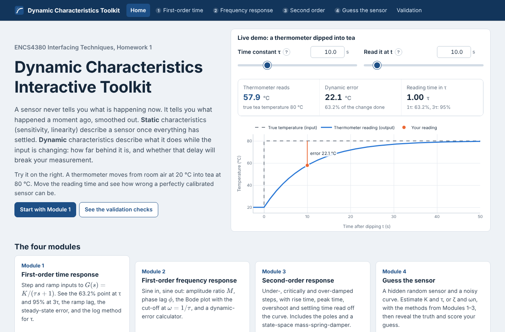
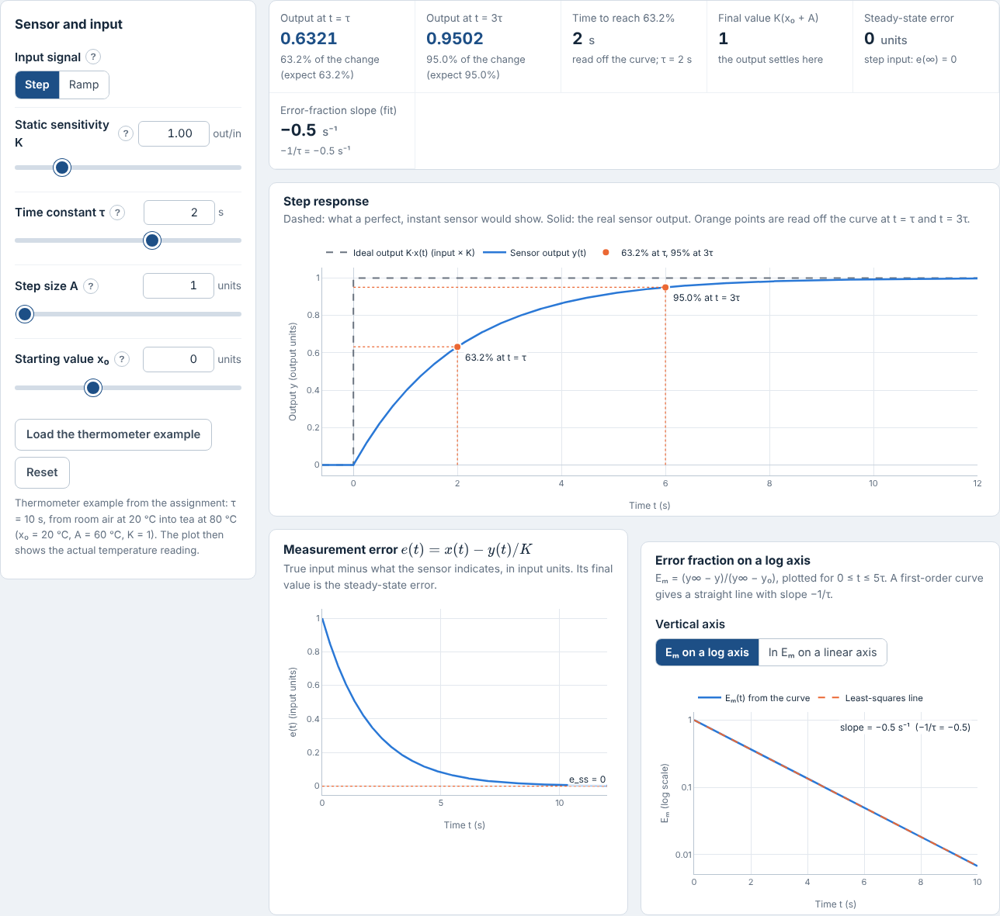
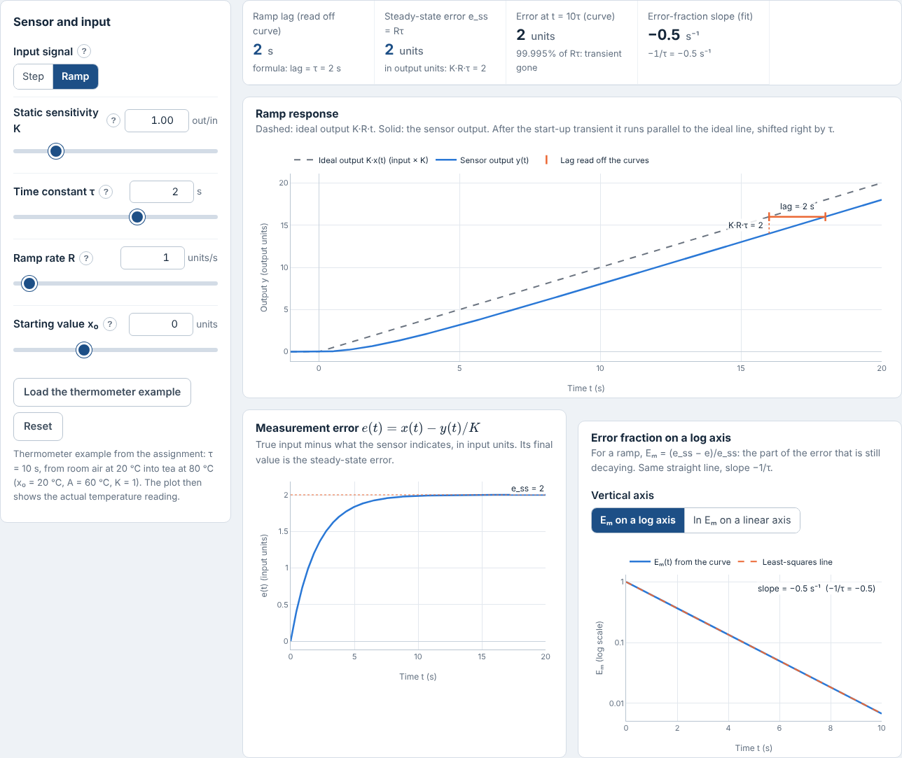
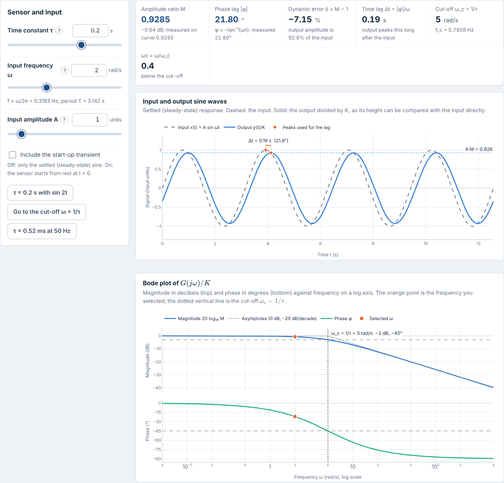
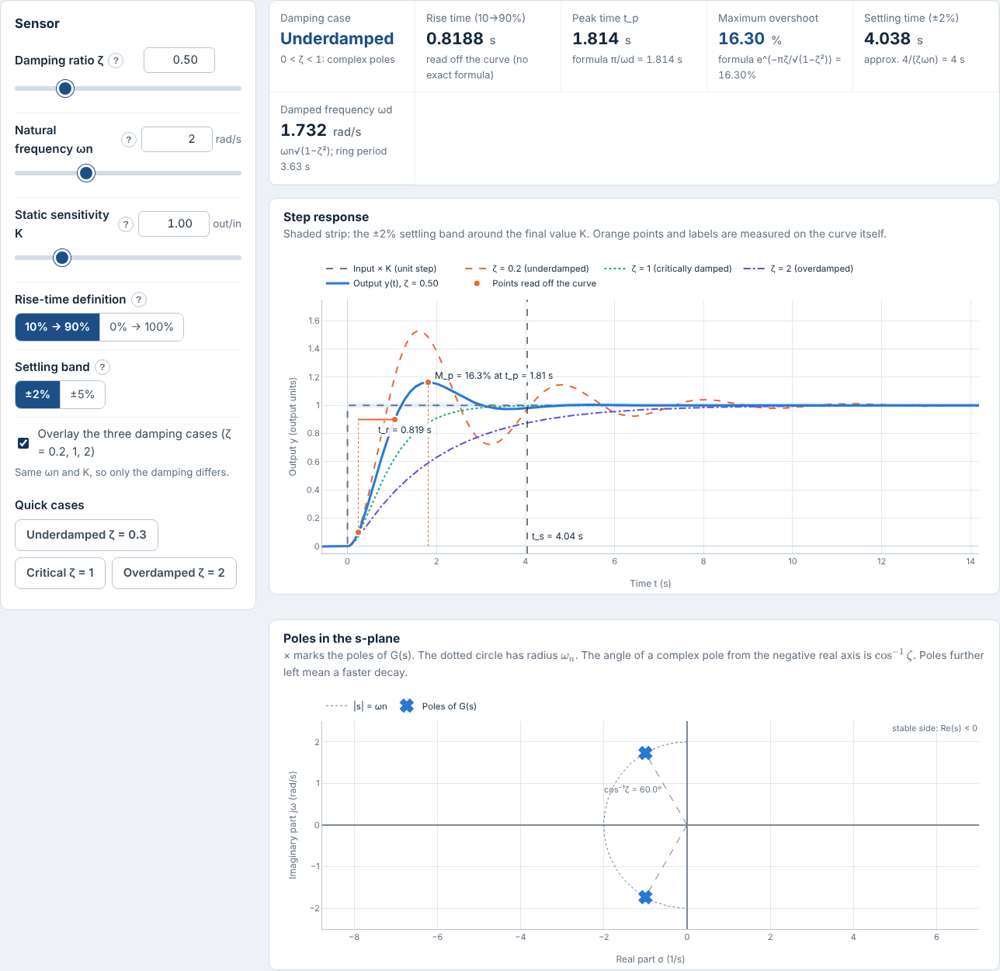
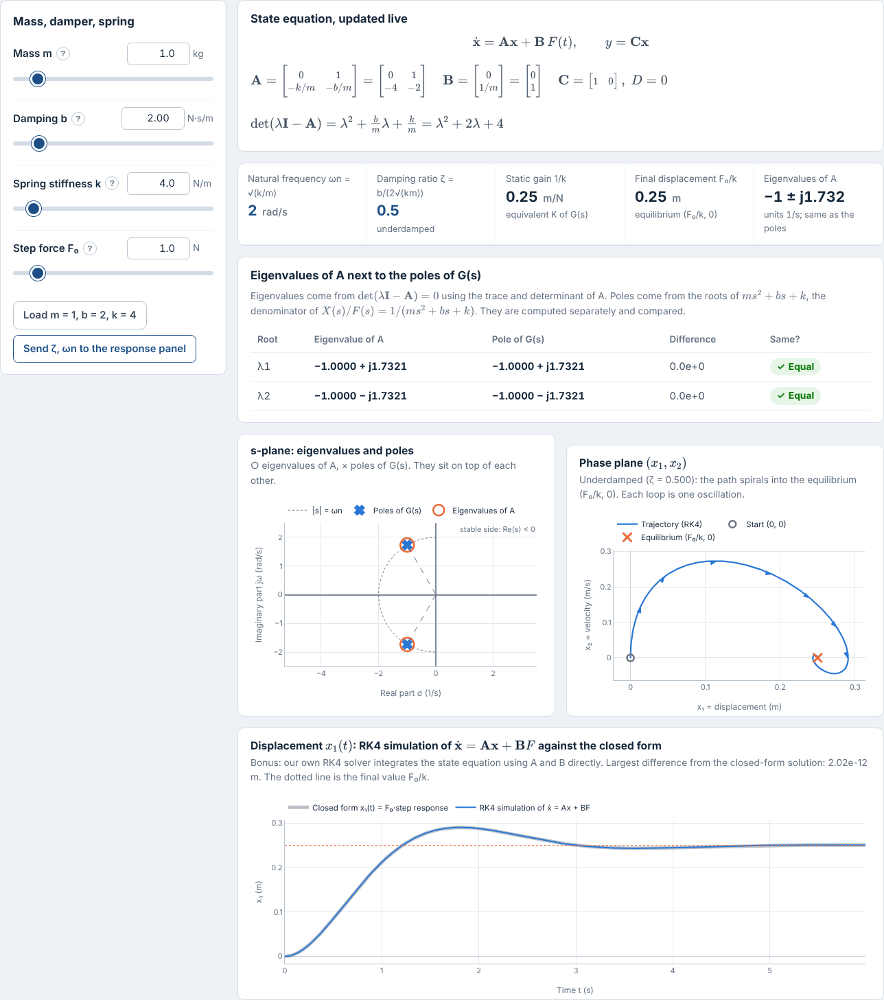
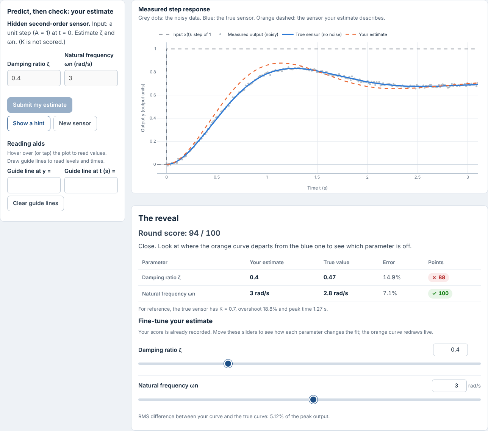
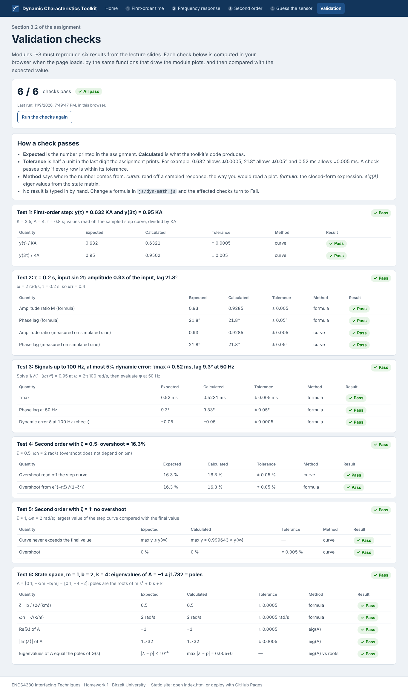
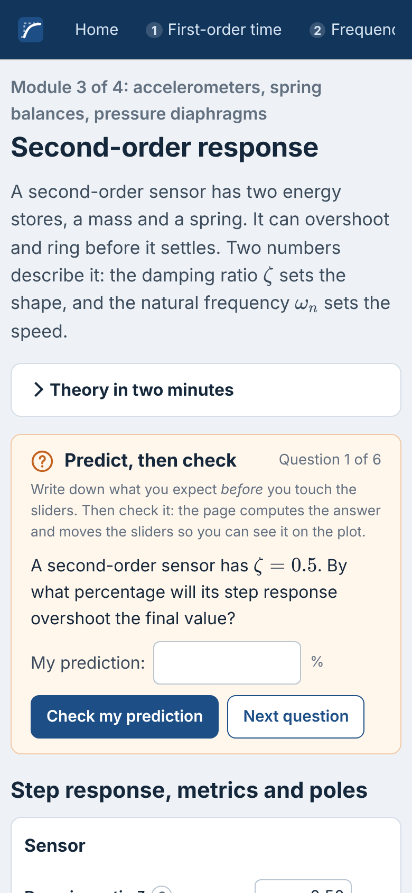

# Dynamic Characteristics Interactive Toolkit

ENCS4380 Interfacing Techniques, Birzeit University.

* **Part A: Homework 2, PID control** (the new **Control** section, `control.html`). The Homework 1 plant models now sit inside a feedback loop with a PID controller.
* **Part B: Homework 1, sensor dynamics.** First-order time and frequency response, second-order response with a state-space panel, and a "Guess the sensor" challenge. Unchanged and still working; its README is further down.

Everything is a static website: no server, no database. Every slider redraws its plots immediately and every validation check is computed live on the page.

> **Live site:** `https://<github-username>.github.io/encs4380-dynamics-<group-name>/`
> *(Replace this line with your real GitHub Pages link once Pages is switched on. See "Deploy to GitHub Pages" in Part B.)*

**Start here for Homework 2:** open `control.html` (linked from the landing page `index.html`). Extra material for the demo and the grading audit is in [docs/HW2_DEMO_AND_AUDIT.md](docs/HW2_DEMO_AND_AUDIT.md).

## Contents

* **Part A: Homework 2**: [Modules and owners](#a1-modules-and-owners) · [Validation results](#a2-validation-results-homework-2) · [Tests](#a3-tests) · [Files added](#a4-files-added-in-homework-2) · [How the simulation works](#a5-how-the-simulation-works) · [My System](#a6-my-system-what-is-real-and-what-is-still-a-placeholder) · [GitHub: issues, commits, release v2.0](#a7-github-issues-commits-and-release-v20) · [Definitions and assumptions](#a8-definitions-and-assumptions) · [Use of AI assistants](#a9-use-of-ai-assistants-homework-2)
* **Part B: Homework 1**: [what it does](#what-the-toolkit-does) · [project structure](#project-structure) · [run locally](#run-it-locally) · [deploy to GitHub Pages](#deploy-to-github-pages) · [team](#team-members-and-responsibilities) · [GitHub workflow](#github-workflow-issues-commits-collaborator) · [release v1.0](#release-v10-checklist)

---

# Part A: Homework 2, PID control

## A1. Modules and owners

| Page | Module | The user can change | The page shows | Owner (fill in) | Issue |
|---|---|---|---|---|---|
| `p1.html` | **P1: PID playground** | first- or second-order plant, Kp, Ki, Kd, setpoint step, control limits, anti-windup | block diagram, output against setpoint, control signal with its limits, P/I/D parts of u, live rise time, overshoot, settling time, steady-state error, closed-loop equation | | #5 |
| `p2.html` | **P2: A slow sensor in the loop** | sensor τs, plant, Kp, Ki, Kd, limits | true output and sensor reading on one plot, control signal, overshoot against τs (sweep), presets for stable / ringing / oscillating | | #6 |
| `p3.html` | **P3: Digital PID** | sampling time Ts, plant, gains, limits, anti-windup on/off | stair-step u[k], sampled measurements, performance against Ts (sweeps), windup presets, **Arduino code with a Copy button** | | #7 |
| `p4.html` | **P4: Tuning challenge** | Kp, Ki, Kd; open-loop step test; new challenge / reset / reveal | hidden random plant (Homework 1 Module 4 model), spec for overshoot, settling time and steady-state error, PASS/FAIL for each, score 0–100 | | #8 |
| `mysystem.html` | **My System** (project) | K, τ (typed or computed from a pasted step-test log), spec, ζ, ωn, Ts | transfer function, source of numbers, spec and why, PI design, 7 checks (ζ in 0.6–0.8, PWM in 0–100%, …), response, PWM plot, Arduino code | | #9 |
| `control-validation.html` | **Validation checks** | nothing (re-run button) | the three checks of Section 2.1: expected, actual, deviation, tolerance, pass/fail, plots | | #10 |
| `zn.html` | **Bonus: Ziegler–Nichols** | plant, sensor and driver lags, rule P/PI/PID, "before" gains | Ku and Pu from simulation and from the −180° frequency crossing, rule table, response before and after | | #11 |

Every module page has a **"Predict, then check"** box whose answers are computed by the same engine (not typed in), and the options are shuffled so the right answer is not always in the same place.

*(Issue numbers are suggestions: Homework 1 used #1–#4.)* If your group has fewer people than modules, give one person two modules and say so here.

## A2. Validation results (Homework 2)

The plant is G(s) = K/(τs + 1) with K = 1, τ = 1 s. The checks are computed in the browser by `js/control-validation.js` on `control-validation.html`, and from the command line by `npm test`. "Actual" values are measured on the RK4 closed-loop simulation. Control limits are **off** for these checks (with Kp = 9 the first control value is 9, which a 0–1 limit would clip).

| # | Check (assignment, Section 2.1) | Expected | Actual (simulation) | Deviation | Result |
|---|---|---|---|---|---|
| 1 | P only, Kp = 9: closed-loop τ (63.2% point) | 0.1 s | 0.1000 s | 8×10⁻¹² | Pass |
| 1 | same, from the slope of ln(1 − y/y∞) | 0.1 s | 0.1000 s | 8×10⁻¹² | Pass |
| 1 | steady-state error | 10% | 10.000% | −3×10⁻¹³ | Pass |
| 1 | final output for a unit step | 0.9 | 0.9000 | 3×10⁻¹⁵ | Pass |
| 2 | PI Kp = 1, Ki = 1: characteristic equation | s² + 2s + 1 = 0 | coefficients 1, 2, 1 | 0 | Pass |
| 2 | ωn (formula, and from eigenvalues of the closed-loop state matrix) | 1 rad/s | 1.0000 | 0 | Pass |
| 2 | ζ (formula, and from eigenvalues) | 1 | 1.0000 | 0 | Pass |
| 2 | RK4 response against the exact 1 − e⁻ᵗ (the zero cancels one pole) | 0 | max deviation 4×10⁻¹² | 4×10⁻¹² | Pass |
| 2 | overshoot of the simulated response | 0% | 0% | 0 | Pass |
| 3 | five stable PI loops (first and second order, positive and negative steps): steady-state error | 0 | 0.00007% to 0.005% of r | ≤ 5×10⁻³ % | Pass (tolerance 0.1%) |

Tolerances are 2% on a time constant, 0.05 percentage points on an error, 0.001 on ωn and ζ, 10⁻⁴ on a curve compared with its exact solution. The residual in test 3 is the finite tail window of the run, not slack in the tolerance. Test 1 also shows, as information, that a 0–1 limit would stretch the 63.2% point from 0.1 s to 0.84 s.

## A3. Tests

```bash
npm test                    # both suites: 35 tests (Homework 1) and 43 tests (Homework 2)
node tests/pid-sim.test.js  # Homework 2 only
```

`tests/pid-sim.test.js` (no dependencies) compares the engine with independent answers, not with itself:

* RK4 against the closed-form first- and second-order loops, and against an exact discrete-time recursion written in the test (exact solution of the plant under a zero-order hold);
* P, I, D effects (including that D damps a second-order plant but only adds inertia, τ + K·Kd, to a first-order one);
* sensor lag: overshoot grows with τs, the PI stability limit (τ+τs)(1+K·Kp) > τ·τs·K·Ki (Routh) agrees with the simulation;
* digital loop: u held between samples, discrete stability limit Ts < 0.223 s for Kp = 9, anti-windup, saturation;
* **the generated Arduino code is transpiled to JavaScript and run sample by sample against the simulated controller** (anti-windup on and off);
* Ziegler–Nichols: Ku from time-domain bisection equals Ku from the −180° crossing; no Ku for first-order plants;
* 20 random tuning challenges: the reference controller meets its own spec; doing nothing or P-only does not;
* identification of K and τ from a noisy synthetic step test; zero gains, invalid parameters, unstable loops.

What was **not** tested automatically: the generated sketch was never compiled in the Arduino IDE or run on hardware (see [the audit](docs/HW2_DEMO_AND_AUDIT.md)). Browser checks done by hand on this build: all pages load without console errors; every preset, slider and Predict question was exercised by script; the Copy button was checked with a real click; layouts were checked at 375 px width.

## A4. Files added in Homework 2

```
control.html                 Control section home: live demo, module map, demo route
p1.html … p4.html            The four modules
mysystem.html                My System: the Micromouse drive motor
control-validation.html      The three Homework 2 validation checks
zn.html                      Bonus: Ziegler–Nichols
js/pid-sim.js                Closed-loop engine: RK4, plants, sensor, saturation, anti-windup, digital PID,
                             metrics, Arduino code generator, identification, Z-N, challenge generator
js/control-validation.js     The three checks (browser and Node)
js/control-ui.js             Shared UI: header, plant/gain/limit controls, block diagram, plots, code box
js/p1.js … p4.js, mysystem.js, zn.js, control-hub.js, control-validation-page.js    page logic
tests/pid-sim.test.js        43 tests for Homework 2
docs/HW2_DEMO_AND_AUDIT.md   Demo plan, instructor questions, equation map, grading audit
```

Modified Homework 1 files: only the navigation bar (a "Control (HW2)" link) in `index.html`, `module1.html` … `module4.html`, `validation.html`; a Control section and a button on `index.html`; new rules appended to `css/style.css`; `package.json` (test script and version). `js/dyn-math.js`, `js/ui.js` and all Homework 1 module scripts are untouched and are reused (`DynMath` for models and metrics, `UI` for sliders, plots and "Predict, then check").

## A5. How the simulation works

* **Numerical closed loop, no closed forms.** `PIDSim.simulate()` steps the loop with RK4. States: plant output (and velocity for second order), sensor output, integral of the error, derivative filter, actuator lag.
* **Plants** (Homework 1): first order τẏ + y = Ku; second order ÿ + 2ζωnẏ + ωn²y = Kωn²u.
* **Sensor** (P2): τsẏm + ym = y. The controller computes e = r − ym.
* **Digital PID** (P3): the assignment equation, run only at t = kTs, u held between samples. The plant is integrated with its own, much smaller RK4 step h, with Ts/h sub-steps per sample, so **the integration step and the sampling time are independent**.
* **Step size** is chosen from the stiffest rate in the loop, h = 0.25/λ (RK4 is stable for hλ < 2.7). The number of steps is capped; if the cap is hit the page says accuracy is reduced.
* **Saturation and anti-windup:** u is clipped to [umin, umax]. Anti-windup is conditional integration: the integral stops accumulating while the output is saturated and the error would push it further into the limit. The same rule is in the Arduino code.
* **Unstable or never-settling loops** are detected (`diverged`, `growing`, `oscillating`, `slow`, `no-response`). The page shows a clear message, clips the plot, and does not print numbers that need a final value.

## A6. My System: what is real and what is still a placeholder

The page is fully functional: you can **type K and τ**, or **paste a logged PWM step test** (time, encoder speed) and the page computes K = Δy/ΔU and τ (63.2% method and log-slope method), shows the data against the fitted model, and uses the result. It then designs a PI controller from a target ζ and settling time, checks that the PWM stays in 0–100%, simulates both the continuous and the digital (Ts) controller, and generates the Arduino code.

> **No real motor measurement is included.** The numbers shown when the page first opens (K = 4 mm/s per %, τ = 0.08 s, 300 mm/s step) are **illustrative placeholders** so that every page can be tested. They are labelled that way on the page and in the header of the generated code. The "synthetic example" button creates fake data only to try the tool and never marks the numbers as measured. **Before submission the group must:**
>
> 1. Run a PWM step test on the real robot (procedure and a logger sketch are on the page), paste the log, and press "Use K and τ".
> 2. Choose "Measured by our group" and write the source and conditions (battery voltage, load, date).
> 3. Review the specification and write the group's own reasoning in the notes box.
> 4. Copy the final gains, a screenshot and the generated code into this README.
> 5. (Hardware bonus only) run the controller on the robot and plot the measured response against the simulation.

Parameters are saved in the browser (`localStorage`) so that P1, P2, P3 and the bonus page can load the project motor with one button.

## A7. GitHub: issues, commits and release v2.0

This folder was **not a git repository** when this work was prepared, so no commits, issues or tags were created. Do the following in the same repository as Homework 1 (it already contains the Homework 1 files).

**1. Add the new files and commit them as their real authors.** Each member commits their own module from their own account, and a Pull Request closes its issue (see the Homework 1 workflow in Part B):

```bash
git checkout -b hw2-p1-playground
git add p1.html js/p1.js
git commit -m "P1: PID playground page and logic (#5)"
git push -u origin hw2-p1-playground
```

Shared files (`js/pid-sim.js`, `js/control-ui.js`, `js/control-validation.js`, `css/style.css`, `tests/pid-sim.test.js`) should be committed first by one member, then each owner adds their page. Do not upload everything in one commit and do not commit under someone else's name.

**2. One issue per module, assigned to its owner** (GitHub: Issues → New issue → Assignees):

| Issue | Title | Checklist to paste |
|---|---|---|
| #5 | P1: PID playground | `- [ ] plant, Kp, Ki, Kd, setpoint, limits` `- [ ] block diagram` `- [ ] output vs setpoint, control signal with limits` `- [ ] rise time, overshoot, settling time, steady-state error` `- [ ] Predict, then check` `- [ ] validation presets match Section 2.1` |
| #6 | P2: A slow sensor in the loop | `- [ ] sensor τs in the feedback path` `- [ ] true and measured output on one plot` `- [ ] overshoot grows to oscillation (presets)` `- [ ] Predict, then check` |
| #7 | P3: Digital PID | `- [ ] stair-step control signal` `- [ ] Ts, gains, anti-windup` `- [ ] performance vs Ts` `- [ ] windup presets` `- [ ] Arduino code and Copy button` `- [ ] Predict, then check` |
| #8 | P4: Tuning challenge | `- [ ] hidden random plant (Homework 1 model)` `- [ ] spec and PASS/FAIL per part, score` `- [ ] new challenge, reset` `- [ ] Predict, then check` |
| #9 | My System | `- [ ] real K and τ from a step test` `- [ ] source documented` `- [ ] spec justified` `- [ ] PI design, ζ in 0.6–0.8, PWM in 0–100%` `- [ ] code generated` |
| #10 | Validation checks | `- [ ] three checks pass` |
| #11 | Bonus: Ziegler–Nichols | `- [ ] Ku and Pu` `- [ ] rules and before/after` |

With the GitHub CLI (replace the usernames):

```bash
gh issue create --title "P1: PID playground" --body "Checklist in the README, A7" --assignee <github-username>
```

**3. Release v2.0** (only after the checklist in [docs/HW2_DEMO_AND_AUDIT.md](docs/HW2_DEMO_AND_AUDIT.md) is done and the group agrees):

```bash
git checkout main && git pull
npm test
git tag -a v2.0 -m "Homework 2 final release"
git push origin v2.0
```

Then turn the tag into a release on GitHub (Releases → Draft a new release → choose `v2.0`) and post the Pages link on the course page. The GitHub Pages setup from Homework 1 applies unchanged: all paths are relative, and `.nojekyll` is present.

## A8. Definitions and assumptions

| Item | Used here | Where |
|---|---|---|
| Rise time | 10% → 90% of the final value y∞ | `closedLoopMetrics()` in `js/pid-sim.js` (uses Homework 1 `stepMetrics`) |
| Overshoot | 100·(y_peak − y∞)/y∞, never negative. If the output has not settled it is measured against r | same |
| Settling time | last time |y − y∞| > 2% of y∞ | same |
| y∞ and steady-state error | y∞ = mean of the last 10% of the run; e_ss = r − y∞ (also in % of r). Shown only if the output has settled | same |
| Time window | automatic: 15 time scales, doubled up to 3 times until settled; then cropped and re-simulated densely for the plot | `analyze()` |
| Continuous D term | derivative **of the measurement**, first-order filtered (Tf = 0.05 × fastest time constant). For a constant setpoint this equals Kd·de/dt, and it avoids an infinite spike when the setpoint jumps | `simulate()` |
| Digital D term | the assignment equation on the error, e[−1] = 0. So at k = 0 there is a short "derivative kick" Kd·r/Ts, clipped to the limit | `simulate()`, `arduinoCode()` |
| Anti-windup | conditional integration (stop adding to the integral while saturated and pushing further into the limit) | `simulate()` |
| Derivative on a first-order plant | closed loop (τ + K·Kd)s² + (1 + K·Kp)s + K·Ki: D adds inertia, so it can **increase** overshoot. On a second-order plant it adds damping. The pages say so | P1 theory and questions |
| Tuning challenge | hidden plant from `DynMath.randomSensor` (first order K, τ or second order K, ζ, ωn). A random search finds a reference controller (overshoot ≤ 5%, error ≤ 0.5%); the spec is overshoot ≤ 10/15/20%, settling ≤ 1.6 × the reference time, error ≤ 1%. Score: overshoot 30, settling 40, error 30 | `makeChallenge()`, `evaluateSpec()` |
| My System design | ωn = 4/(ζ·ts), Kp = (2ζτωn − 1)/K, Ki = τωn²/K. The PI zero adds overshoot beyond the second-order formula, so the simulation is the judge | `designPI()` |
| Ziegler–Nichols | Ku by bisection on the time-domain simulation (peaks grow or decay) and from the −180° frequency crossing; rules P 0.5Ku; PI 0.45Ku, Ti = Pu/1.2; PID 0.6Ku, Ti = Pu/2, Td = Pu/8 | `ultimateFromSimulation()`, `zieglerNichols()` |

## A9. Use of AI assistants (Homework 2)

The assignment allows AI coding assistants but requires the README to say what they were used for. **Edit this paragraph so that it is true for your group:**

> For Homework 2 we used an AI assistant (Claude Code, by Anthropic) to draft the closed-loop simulation engine (`js/pid-sim.js`), the Control pages, the unit tests and the documentation, building on our Homework 1 code. We then [describe what each member did: reviewed, ran, changed, tested on the robot]. Each member can explain the code and the equations of their own module. The validation values come from running the simulation (`npm test` and `control-validation.html`), not from the AI's text. The motor parameters on the My System page are [placeholders / measured on date X].

---

# Part B: Homework 1, sensor dynamics



## Contents

1. [What the toolkit does](#what-the-toolkit-does)
2. [Screenshots](#screenshots)
3. [Validation results](#validation-results)
4. [Project structure](#project-structure)
5. [Run it locally](#run-it-locally)
6. [Deploy to GitHub Pages](#deploy-to-github-pages)
7. [Team members and responsibilities](#team-members-and-responsibilities)
8. [GitHub workflow: issues, commits, collaborator](#github-workflow-issues-commits-collaborator)
9. [Release v1.0 checklist](#release-v10-checklist)
10. [Definitions and assumptions](#definitions-and-assumptions)
11. [Use of AI assistants](#use-of-ai-assistants)
12. [Libraries and licences](#libraries-and-licences)

---

## What the toolkit does

| Module | Model | The user can change | The page shows |
|---|---|---|---|
| **1. First-order time response** | τẏ + y = Kx, G(s) = K/(τs + 1) | K, τ, input (step or ramp), step size A, ramp rate R, starting value x₀ | Step and ramp responses; the 63.2% point at t = τ and 95% at t = 3τ (read off the curve); ramp lag = τ measured between the curves; steady-state error (0 for a step, Rτ for a ramp); measurement error e(t); the error fraction Eₘ on a log axis with a least-squares slope of −1/τ |
| **2. First-order frequency response** | M = 1/√(1 + (ωτ)²), φ = −tan⁻¹(ωτ) | τ, input frequency ω, amplitude, start-up transient on/off | Input and output sines on one plot with the peak-to-peak lag; amplitude ratio and phase lag (formula and measured on the curve); Bode magnitude and phase with the cut-off ω = 1/τ marked; a dynamic-error calculator δ = M − 1 (check a sensor, or design τmax for a bandwidth) |
| **3. Second-order response** | G(s) = Kωn²/(s² + 2ζωn s + ωn²) | ζ, ωn, K, rise-time definition, settling band, overlay of the three damping cases | Under-, critically and over-damped step responses; rise time, peak time, maximum overshoot and settling time read off the curve, with formula values for comparison; poles in the s-plane |
| **3. State-space panel** | ẋ = [0 1; −k/m −b/m]x + [0; 1/m]F, y = [1 0]x | m, b, k, step force F₀ | A, B and C updated live; ωn = √(k/m), ζ = b/(2√(km)); eigenvalues of A next to the poles of G(s) (computed separately) on the s-plane; the phase-plane path (x₁, x₂) (a spiral when underdamped, no spiral when overdamped); **bonus:** our own RK4 solver plotted against the closed form |
| **4. Guess the sensor** | Modules 1 and 3 | Nothing until the guess is made | A hidden random first- or second-order sensor; a noisy step response (or, for some first-order sensors, a sine at a stated frequency); estimate K and τ, or ζ and ωn; hints on request; reading aids (guide lines, log-method view); reveal with true-versus-guess overlay; score with full marks within 10%; "New sensor" button; running session score |

Every module has a **"Predict, then check"** box. The user types a prediction, the page computes the answer with the same model code, judges the prediction, and moves the sliders to that case so it can be seen on the plot.

---

## Screenshots

| Module 1: step response | Module 1: ramp response |
|---|---|
|  |  |

| Module 2: sines and Bode plot | Module 3: second-order response |
|---|---|
|  |  |

| Module 3: state-space panel | Module 4: the reveal |
|---|---|
|  |  |

| Validation page | On a phone (390 px) |
|---|---|
|  |  |

---

## Validation results

The checks are computed in the browser by `js/validation.js`, which calls the same functions in `js/dyn-math.js` that draw the plots. Nothing is typed in as "pass". A check passes when every value is within half a unit of the last digit printed in the assignment.

| # | Check (assignment, Section 3.2) | Expected | Calculated by the toolkit | Result |
|---|---|---|---|---|
| 1 | First-order step, y(τ)/KA and y(3τ)/KA | 0.632, 0.95 | 0.6321, 0.9502 | Pass |
| 2 | τ = 0.2 s, input sin 2t: amplitude ratio, phase lag | 0.93, 21.8° | 0.9285, 21.80° | Pass |
| 3 | 100 Hz with at most 5% dynamic error: τmax, lag at 50 Hz | ≈ 0.52 ms, 9.3° | 0.5231 ms, 9.33° | Pass |
| 4 | ζ = 0.5: overshoot | 16.3% | 16.30% (read off the curve) | Pass |
| 5 | ζ = 1: overshoot | none | 0% (curve never exceeds its final value) | Pass |
| 6 | m = 1, b = 2, k = 4: ζ, ωn, eigenvalues of A | 0.5, 2 rad/s, −1 ± j1.732 | 0.5, 2, −1 ± j1.7321; equal to the poles (difference 0) | Pass |

Run the same checks, plus 29 other unit tests of the maths, from the command line:

```bash
node tests/dyn-math.test.js      # or: npm test
```

---

## Project structure

```
encs4380-dynamics-<group-name>/
├── index.html              Home: introduction, live thermometer demo, module map, demo route
├── module1.html            Module 1: first-order time response
├── module2.html            Module 2: first-order frequency response
├── module3.html            Module 3: second-order response + state-space panel
├── module4.html            Module 4: Guess the sensor
├── validation.html         The six validation checks
├── css/
│   └── style.css           All styling (responsive layout, controls, readouts)
├── js/
│   ├── dyn-math.js         Shared maths: every model, metric, eigenvalue, RK4, random sensor, score
│   ├── ui.js               Shared UI: sliders, toggles, Plotly helpers, KaTeX, "Predict, then check"
│   ├── validation.js       The six checks (runs in the browser and in Node)
│   ├── validation-page.js  Validation page summary
│   ├── home.js             Home page demo
│   ├── module1.js          Module 1 logic
│   ├── module2.js          Module 2 logic
│   ├── module3.js          Module 3 logic (response + state space)
│   └── module4.js          Module 4 logic
├── tests/
│   └── dyn-math.test.js    Unit tests for the maths and the validation checks (Node, no dependencies)
├── vendor/                 Plotly.js 4.2.0 and KaTeX 0.19.1, stored locally so the site works offline
├── assets/favicon.svg
├── docs/screenshots/       Images used in this README
├── package.json            Only defines `npm test`
├── .nojekyll               Tells GitHub Pages to serve files as they are
└── README.md
```

How the parts talk to each other: a slider fires an `input` event → the module's `update()` reads all slider values → calls functions in `dyn-math.js` → passes the arrays to `Plotly.react`, which redraws only what changed. Redraws are throttled to one per animation frame so dragging stays smooth.

---

## Run it locally

No build step and no server code are needed.

* **Quickest:** double-click `index.html`. Everything, including Plotly and KaTeX, loads from the `vendor/` folder, so it also works without internet. This is useful if the lab Wi-Fi fails during the demo.
* **Like GitHub Pages:** serve the folder and open http://localhost:8000

  ```bash
  python -m http.server 8000
  ```
* **Tests (optional, needs Node.js 18+):** `npm test`

---

## Deploy to GitHub Pages

1. Create a **public** repository named `encs4380-dynamics-<group-name>` (assignment Section 5).
2. Put the contents of this folder at the **root** of the repository (so `index.html` is at the top level) and push to the `main` branch.
3. On GitHub: **Settings → Pages → Build and deployment → Source: Deploy from a branch → Branch: `main`, folder `/ (root)` → Save.**
4. After about a minute the link appears at the top of the Pages settings: `https://<github-username>.github.io/encs4380-dynamics-<group-name>/`. Open it on a phone as well (assignment, "first hour" checklist).
5. Paste the link at the top of this README and on the course page.

Notes:

* `.nojekyll` makes GitHub serve every file as-is, so no Jekyll processing is applied.
* All paths are relative (`css/style.css`, `js/...`), so the site works under the `/<repo-name>/` sub-path that Pages uses.
* When the site runs on `github.io`, the footer links to the repository automatically.

---

## Team members and responsibilities

*Fill this in with your real details. Each module has one owner, who is the person who explains it in the demo.*

| Member (name) | Student ID | GitHub username | Owns | Issue |
|---|---|---|---|---|
| | | | Module 1: first-order time response (`module1.html`, `js/module1.js`) | #1 |
| | | | Module 2: first-order frequency response (`module2.html`, `js/module2.js`) | #2 |
| | | | Module 3: second-order + state space (`module3.html`, `js/module3.js`) | #3 |
| | | | Module 4: Guess the sensor (`module4.html`, `js/module4.js`) | #4 |

Shared parts (`js/dyn-math.js`, `js/ui.js`, `js/validation.js`, `css/style.css`, `index.html`, README): list who did what, for example "validation checks: member X; README and screenshots: member Y". If your group has fewer than four people, give one person two modules and write that here.

---

## GitHub workflow: issues, commits, collaborator

### 1. Add the instructor as a collaborator (day one)

1. Open the repository on GitHub → **Settings** → **Collaborators** (under "Access"). GitHub may ask for your password.
2. Click **Add people**.
3. Search for **`ghanem@staff.birzeit.edu`**, select the account, and send the invitation.
4. Add every group member the same way. Each person must accept the e-mailed invitation.

### 2. One GitHub Issue per module, assigned to its owner

Create four issues (**Issues → New issue**). Suggested titles and bodies:

| Issue | Title | Checklist to paste into the body |
|---|---|---|
| #1 | Module 1: First-order time response | `- [ ] step and ramp responses` `- [ ] 63.2% at τ, 95% at 3τ markers` `- [ ] ramp lag = τ, steady-state error` `- [ ] error-fraction log plot, slope −1/τ` `- [ ] Predict, then check` `- [ ] validation test 1 passes` |
| #2 | Module 2: First-order frequency response | `- [ ] input and output sines on one plot` `- [ ] amplitude ratio and phase lag` `- [ ] Bode plot with cut-off ω = 1/τ` `- [ ] dynamic-error calculator δ = M − 1` `- [ ] Predict, then check` `- [ ] validation tests 2 and 3 pass` |
| #3 | Module 3: Second-order response + state space | `- [ ] three damping cases` `- [ ] tr, tp, Mp, ts read off the curve` `- [ ] poles in the s-plane` `- [ ] A and B update live with m, b, k` `- [ ] eigenvalues next to poles` `- [ ] phase-plane path` `- [ ] Predict, then check` `- [ ] validation tests 4, 5, 6 pass` |
| #4 | Module 4: Guess the sensor | `- [ ] random first/second-order sensor with noise` `- [ ] step or sine response` `- [ ] hints` `- [ ] reveal with overlay` `- [ ] score, full marks within 10%` `- [ ] New sensor button, session score` |

For each issue, use **Assignees** (right-hand panel) to assign its owner. You can also add a label such as `module`.

### 3. Recording individual contributions through commits

The assignment grades "every member's commits", so each person must commit **their own work from their own GitHub account**.

1. Every member sets their identity once, matching their GitHub account:
   ```bash
   git config --global user.name  "Your Name"
   git config --global user.email "the-email-on-your-github-account"
   ```
2. Clone the repository and work on a branch named after the issue:
   ```bash
   git clone https://github.com/<owner>/encs4380-dynamics-<group-name>.git
   cd encs4380-dynamics-<group-name>
   git checkout -b module-2-frequency
   ```
3. Commit small, meaningful steps, and reference the issue in the message:
   ```bash
   git add module2.html js/module2.js
   git commit -m "Module 2: add Bode plot with cut-off marker (#2)"
   git push -u origin module-2-frequency
   ```
4. Open a **Pull Request** into `main` and write `Closes #2` in its description. Another member reviews and merges it. The issue closes automatically and the contribution is recorded under the author's name.
5. Check the history: **Insights → Contributors** on GitHub, or `git shortlog -sn` locally.

Suggested order: one member commits the shared core first (`css/`, `js/dyn-math.js`, `js/ui.js`, `js/validation.js`, `vendor/`, `index.html`). Then each owner adds and commits their own module page and script. Commit as you understand and test each part; don't upload everything in one commit.

### 4. Checkpoints

* Tue 3 Nov 2026: Pages live, Module 1 working.
* Mon 9 Nov 2026: Modules 2 and 3 working.
* Thu 12 Nov 2026: final release v1.0.
* 15–16 Nov 2026: 10-minute group demos plus questions.

---

## Release v1.0 checklist

Before tagging:

- [ ] The GitHub Pages link opens on a laptop **and** a phone; no dead buttons, placeholder links or empty sections.
- [ ] All six checks show **Pass** on `validation.html` (and `npm test` reports 0 failed).
- [ ] Every slider and button on every page has been tried; the browser console (F12) shows no errors.
- [ ] Each module's "Predict, then check" box works.
- [ ] Module 4 played at least five rounds by each member ("If you can't guess the sensor, your users can't either").
- [ ] Rise-time and settling definitions checked against the lecture slides (see below).
- [ ] README: live link, team table, who built which module, screenshots, and the AI-use statement filled in truthfully.
- [ ] Instructor (`ghanem@staff.birzeit.edu`) added as a collaborator; all four issues assigned and closed by pull requests.
- [ ] Every member has commits in the history.
- [ ] Each member can explain every line of their module and every equation on their page.

Create the release:

* **On GitHub:** **Releases → Draft a new release → Choose a tag → type `v1.0` → Create new tag on publish → Target: `main` → Title "v1.0" → Publish release.**
* **Or from the command line:**
  ```bash
  git checkout main && git pull
  git tag -a v1.0 -m "Homework 1 final release"
  git push origin v1.0
  ```
  Then turn the tag into a release on the Releases page.

Finally, post the Pages link on the course page.

---

## Definitions and assumptions

These definitions are used in the code. The assignment says the formulas come from the lecture slides, which were not available while this was written, so **compare these with your slides and change them if they differ.**

| Item | Used here | Where to change it |
|---|---|---|
| Rise time | 10% → 90% by default; 0% → 100% selectable on the page | `stepMetrics()` in `js/dyn-math.js`; toggle in `js/module3.js` |
| Settling time | Last time the curve is outside ±2% (default) or ±5% of the final value | `stepMetrics()`; toggle in `js/module3.js` |
| Settling-time formula shown for comparison | ts ≈ 4/(ζωn) for 2%, 3/(ζωn) for 5% (envelope approximation) | `secondOrderFormulas()` |
| Measurement error (Module 1) | e(t) = x(t) − y(t)/K, true minus indicated, in input units; ramp e_ss = Rτ | `firstOrderMeasurementError()` |
| Error fraction | Eₘ = (y∞ − y)/(y∞ − y₀) for a step; for a ramp, the decaying part of the error (e_ss − e)/e_ss | `errorFraction()`, `js/module1.js` |
| Dynamic error | δ = M − 1 (negative: the output amplitude is too small); "at most 5%" means \|δ\| ≤ 0.05 | `dynamicError()`, `tauMaxForDynamicError()` |
| State-space static gain | X/F = 1/(ms² + bs + k), so K = 1/k, ωn = √(k/m), ζ = b/(2√(km)) | `msdToSecondOrder()` |
| Module 4 score | 100 points per parameter within 10% error, falling linearly to 0 at 50%; round = average of the two parameters | `scoreParameter()` |
| State-space simulation | Our own RK4 (not the Section 7.1 code from the notes, which we did not have) | `rk4()`, `simulateMSD()` |

---

## Use of AI assistants

The assignment allows AI coding assistants but requires the README to say what they were used for. **Edit this paragraph so that it is true for your group:**

> We used an AI assistant (Claude, by Anthropic) to generate the first version of the code, the unit tests and the documentation. Each member then reviewed, tested and [describe any changes you made] the module they own, and can explain every line of it and every equation on its page. The validation values were checked by running the code (`npm test` and `validation.html`), not taken from the AI's text.

---

## Libraries and licences

* [Plotly.js](https://plotly.com/javascript/) 4.2.0, MIT licence (`vendor/plotly/LICENSE`). Plotly's "share to cloud" button is switched off; nothing is uploaded anywhere.
* [KaTeX](https://katex.org/) 0.19.1, MIT licence (`vendor/katex/LICENSE`).

No backend, login, analytics or paid service is used. Module 4 keeps the session score in your browser's session storage only.
