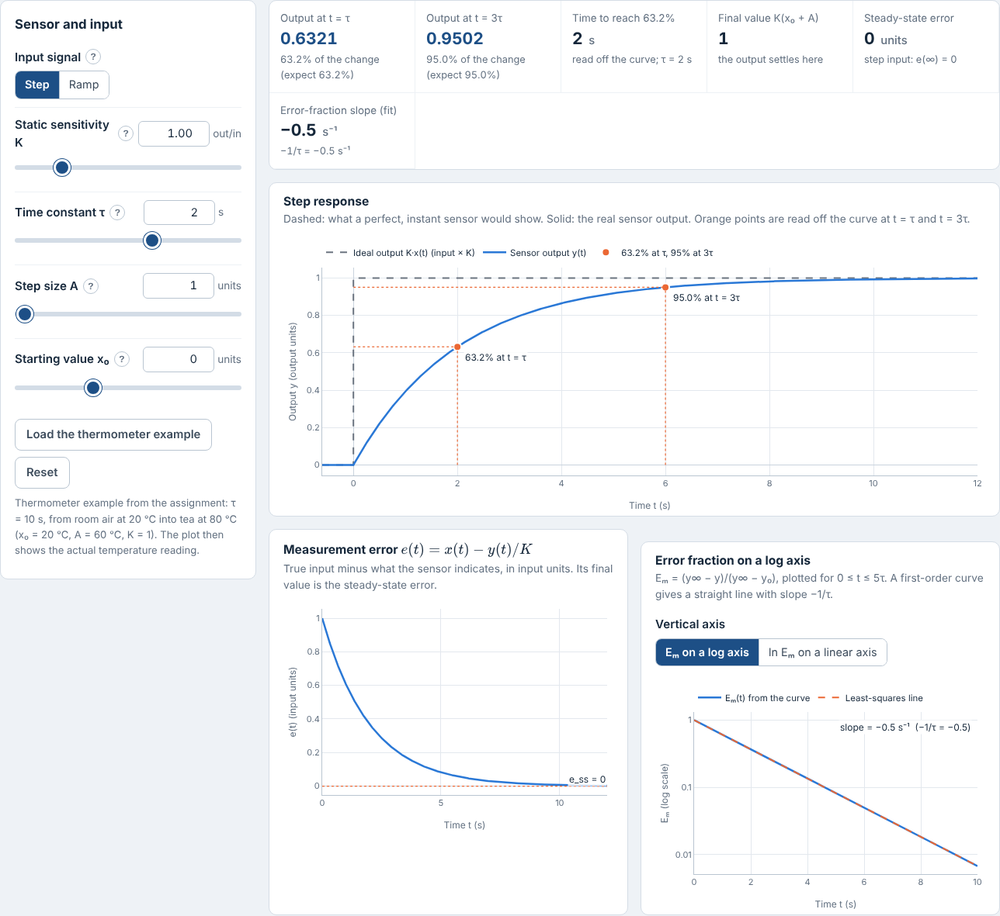
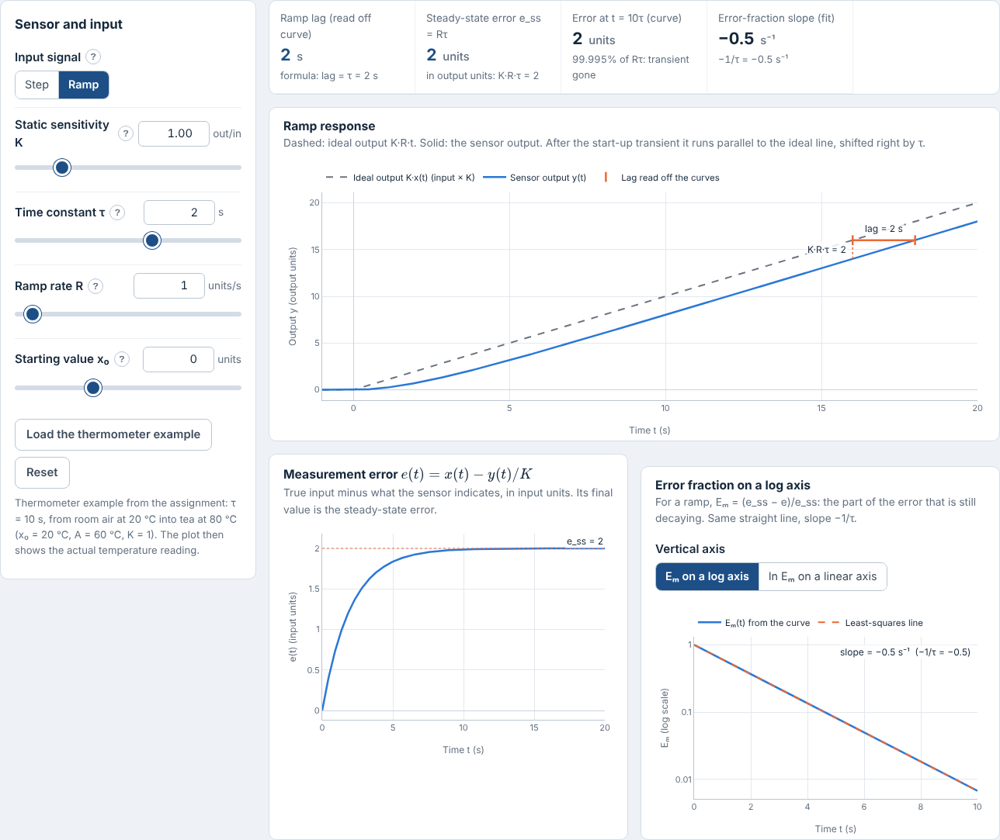
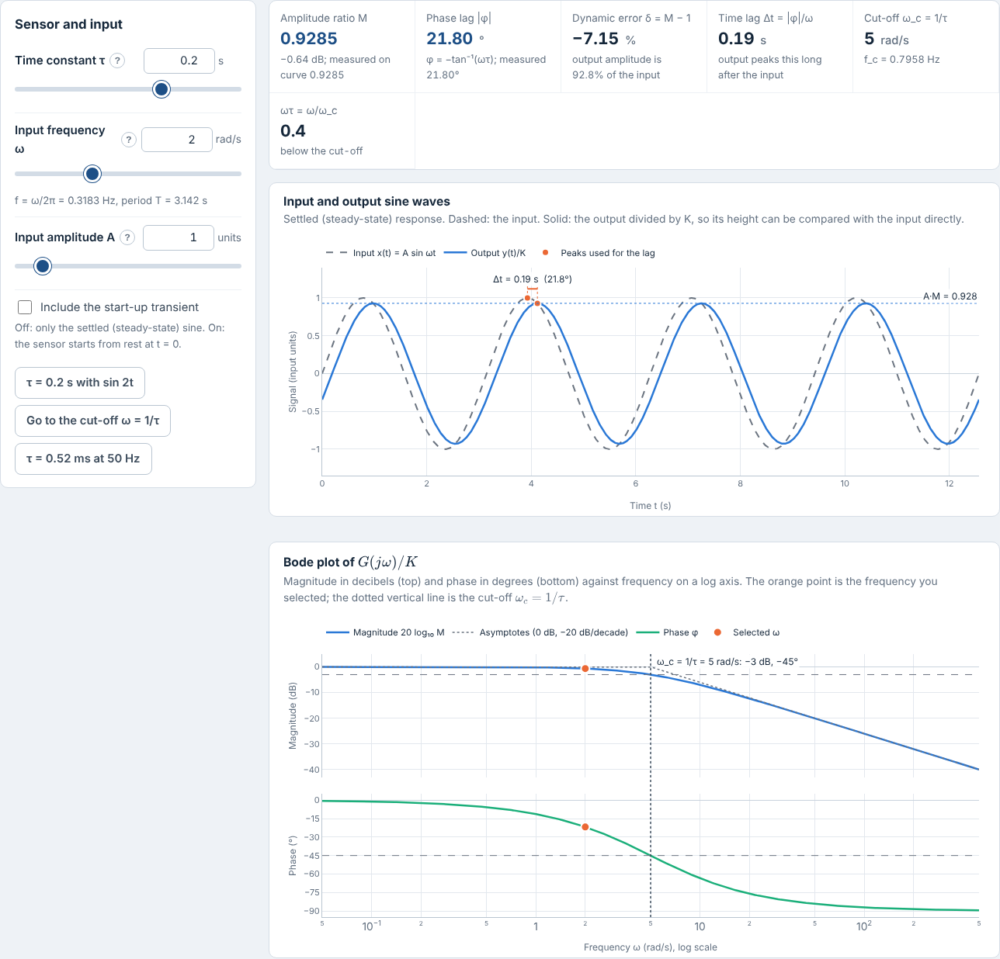
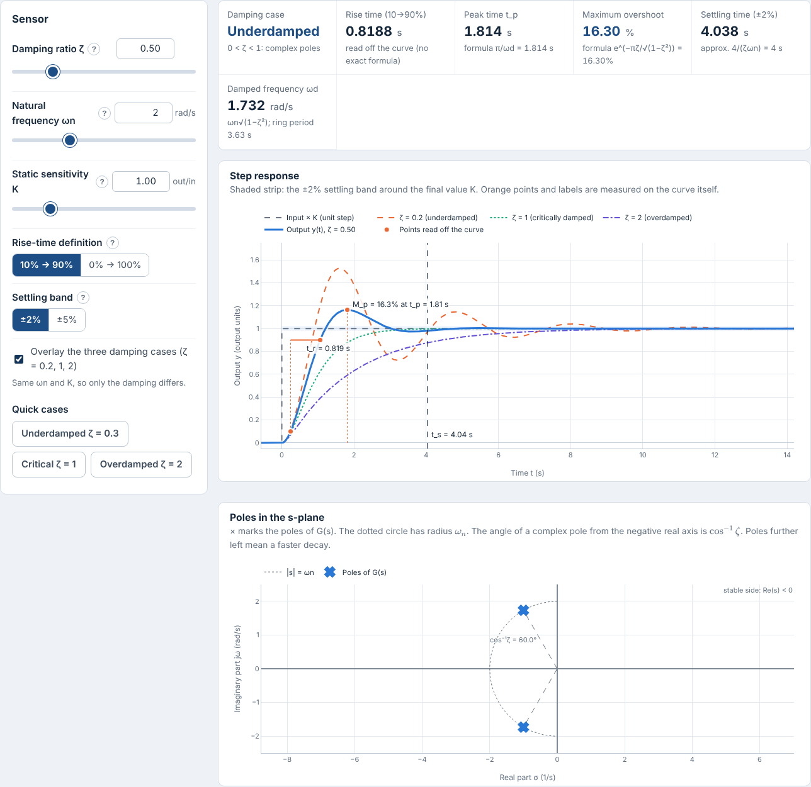
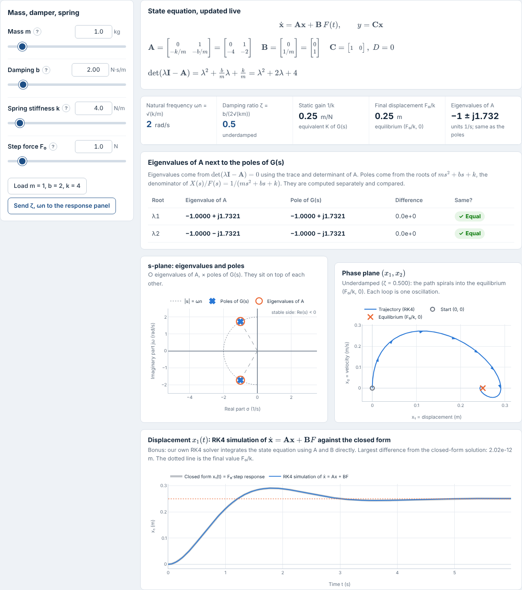
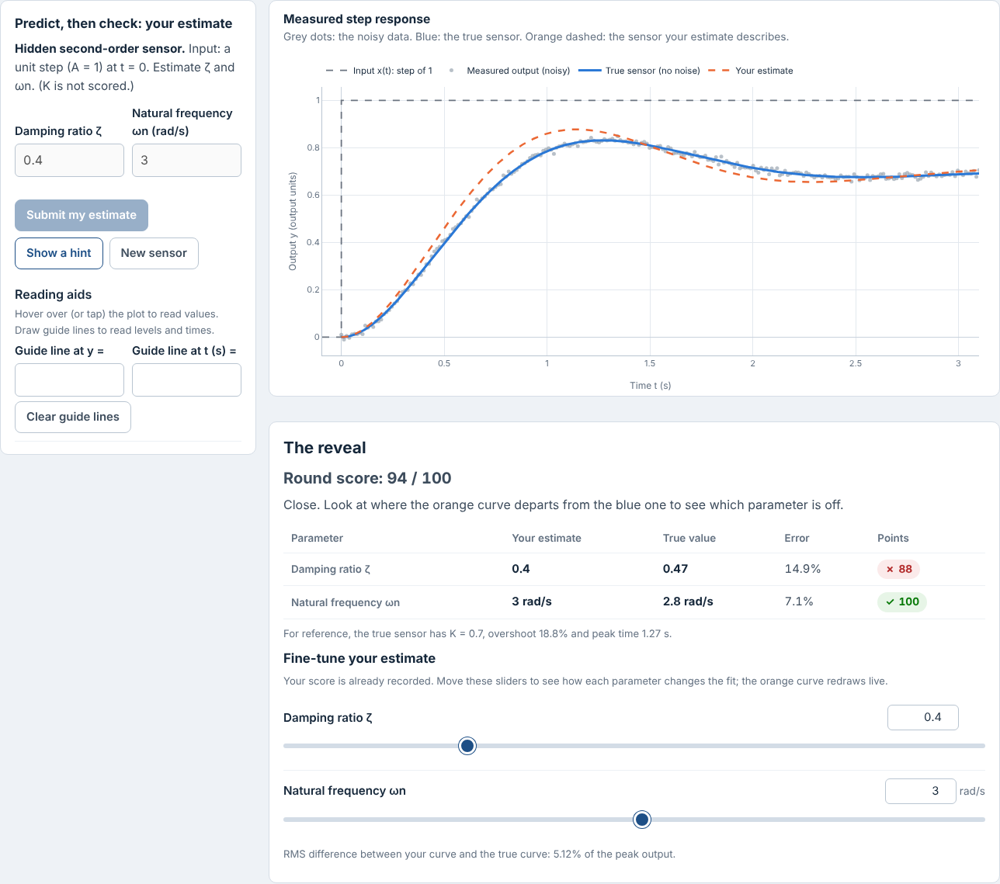
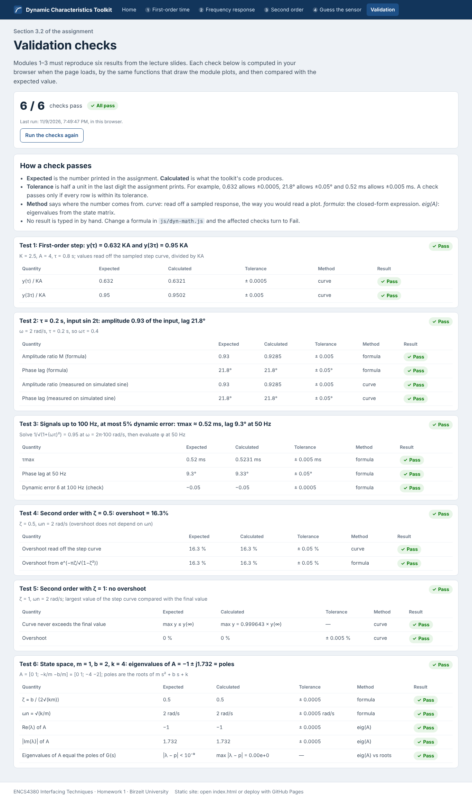
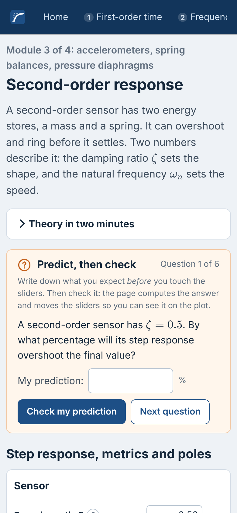

# Dynamic Characteristics Interactive Toolkit

ENCS4380 Interfacing Techniques, Birzeit University: Homework 1.

An interactive, static web toolkit that makes the dynamic characteristics of sensors visible: first-order time and frequency response, second-order response with a state-space panel, and a "Guess the sensor" challenge. Every slider redraws its plots immediately, and all six validation checks from the assignment are computed live on the page.

> **Live site:** https://hibat972-tech.github.io/encs4380-dynamics-T27/
> https://hibat972-tech.github.io/encs4380-dynamics-T27/


---

## Contents

1. [What the toolkit does](#what-the-toolkit-does)
2. [Screenshots](#screenshots)
3. [Validation results](#validation-results)
4. [Project structure](#project-structure)
5. [Run it locally](#run-it-locally)
6. [Deploy to GitHub Pages](#deploy-to-github-pages)
7. [Team members and responsibilities](#team-members-and-responsibilities)
8. [GitHub workflow: issues, commits, collaborator](#github-workflow-issues-commits-collaborator)
9. [Release v1.0 checklist](#release-v10-checklist)
10. [Definitions and assumptions](#definitions-and-assumptions)
11. [Use of AI assistants](#use-of-ai-assistants)
12. [Libraries and licences](#libraries-and-licences)

---

## What the toolkit does

| Module | Model | The user can change | The page shows |
|---|---|---|---|
| **1. First-order time response** | τẏ + y = Kx, G(s) = K/(τs + 1) | K, τ, input (step or ramp), step size A, ramp rate R, starting value x₀ | Step and ramp responses; the 63.2% point at t = τ and 95% at t = 3τ (read off the curve); ramp lag = τ measured between the curves; steady-state error (0 for a step, Rτ for a ramp); measurement error e(t); the error fraction Eₘ on a log axis with a least-squares slope of −1/τ |
| **2. First-order frequency response** | M = 1/√(1 + (ωτ)²), φ = −tan⁻¹(ωτ) | τ, input frequency ω, amplitude, start-up transient on/off | Input and output sines on one plot with the peak-to-peak lag; amplitude ratio and phase lag (formula and measured on the curve); Bode magnitude and phase with the cut-off ω = 1/τ marked; a dynamic-error calculator δ = M − 1 (check a sensor, or design τmax for a bandwidth) |
| **3. Second-order response** | G(s) = Kωn²/(s² + 2ζωn s + ωn²) | ζ, ωn, K, rise-time definition, settling band, overlay of the three damping cases | Under-, critically and over-damped step responses; rise time, peak time, maximum overshoot and settling time read off the curve, with formula values for comparison; poles in the s-plane |
| **3. State-space panel** | ẋ = [0 1; −k/m −b/m]x + [0; 1/m]F, y = [1 0]x | m, b, k, step force F₀ | A, B and C updated live; ωn = √(k/m), ζ = b/(2√(km)); eigenvalues of A next to the poles of G(s) (computed separately) on the s-plane; the phase-plane path (x₁, x₂) (a spiral when underdamped, no spiral when overdamped); **bonus:** our own RK4 solver plotted against the closed form |
| **4. Guess the sensor** | Modules 1 and 3 | Nothing until the guess is made | A hidden random first- or second-order sensor; a noisy step response (or, for some first-order sensors, a sine at a stated frequency); estimate K and τ, or ζ and ωn; hints on request; reading aids (guide lines, log-method view); reveal with true-versus-guess overlay; score with full marks within 10%; "New sensor" button; running session score |

Every module has a **"Predict, then check"** box. The user types a prediction, the page computes the answer with the same model code, judges the prediction, and moves the sliders to that case so it can be seen on the plot.

---

## Screenshots

| Module 1: step response | Module 1: ramp response |
|---|---|
|  |  |

| Module 2: sines and Bode plot | Module 3: second-order response |
|---|---|
|  |  |

| Module 3: state-space panel | Module 4: the reveal |
|---|---|
|  |  |

| Validation page | On a phone (390 px) |
|---|---|
|  |  |

---

## Validation results

The checks are computed in the browser by `js/validation.js`, which calls the same functions in `js/dyn-math.js` that draw the plots. Nothing is typed in as "pass". A check passes when every value is within half a unit of the last digit printed in the assignment.

| # | Check (assignment, Section 3.2) | Expected | Calculated by the toolkit | Result |
|---|---|---|---|---|
| 1 | First-order step, y(τ)/KA and y(3τ)/KA | 0.632, 0.95 | 0.6321, 0.9502 | Pass |
| 2 | τ = 0.2 s, input sin 2t: amplitude ratio, phase lag | 0.93, 21.8° | 0.9285, 21.80° | Pass |
| 3 | 100 Hz with at most 5% dynamic error: τmax, lag at 50 Hz | ≈ 0.52 ms, 9.3° | 0.5231 ms, 9.33° | Pass |
| 4 | ζ = 0.5: overshoot | 16.3% | 16.30% (read off the curve) | Pass |
| 5 | ζ = 1: overshoot | none | 0% (curve never exceeds its final value) | Pass |
| 6 | m = 1, b = 2, k = 4: ζ, ωn, eigenvalues of A | 0.5, 2 rad/s, −1 ± j1.732 | 0.5, 2, −1 ± j1.7321; equal to the poles (difference 0) | Pass |

Run the same checks, plus 29 other unit tests of the maths, from the command line:

```bash
node tests/dyn-math.test.js      # or: npm test
```

---

## Project structure

```
encs4380-dynamics-<group-name>/
├── index.html              Home: introduction, live thermometer demo, module map, demo route
├── module1.html            Module 1: first-order time response
├── module2.html            Module 2: first-order frequency response
├── module3.html            Module 3: second-order response + state-space panel
├── module4.html            Module 4: Guess the sensor
├── validation.html         The six validation checks
├── css/
│   └── style.css           All styling (responsive layout, controls, readouts)
├── js/
│   ├── dyn-math.js         Shared maths: every model, metric, eigenvalue, RK4, random sensor, score
│   ├── ui.js               Shared UI: sliders, toggles, Plotly helpers, KaTeX, "Predict, then check"
│   ├── validation.js       The six checks (runs in the browser and in Node)
│   ├── validation-page.js  Validation page summary
│   ├── home.js             Home page demo
│   ├── module1.js          Module 1 logic
│   ├── module2.js          Module 2 logic
│   ├── module3.js          Module 3 logic (response + state space)
│   └── module4.js          Module 4 logic
├── tests/
│   └── dyn-math.test.js    Unit tests for the maths and the validation checks (Node, no dependencies)
├── vendor/                 Plotly.js 4.2.0 and KaTeX 0.19.1, stored locally so the site works offline
├── assets/favicon.svg
├── docs/screenshots/       Images used in this README
├── package.json            Only defines `npm test`
├── .nojekyll               Tells GitHub Pages to serve files as they are
└── README.md
```

How the parts talk to each other: a slider fires an `input` event → the module's `update()` reads all slider values → calls functions in `dyn-math.js` → passes the arrays to `Plotly.react`, which redraws only what changed. Redraws are throttled to one per animation frame so dragging stays smooth.

---

## Run it locally

No build step and no server code are needed.

* **Quickest:** double-click `index.html`. Everything, including Plotly and KaTeX, loads from the `vendor/` folder, so it also works without internet. This is useful if the lab Wi-Fi fails during the demo.
* **Like GitHub Pages:** serve the folder and open http://localhost:8000

  ```bash
  python -m http.server 8000
  ```
* **Tests (optional, needs Node.js 18+):** `npm test`

---

## Deploy to GitHub Pages

1. Create a **public** repository named `encs4380-dynamics-<group-name>` (assignment Section 5).
2. Put the contents of this folder at the **root** of the repository (so `index.html` is at the top level) and push to the `main` branch.
3. On GitHub: **Settings → Pages → Build and deployment → Source: Deploy from a branch → Branch: `main`, folder `/ (root)` → Save.**
4. After about a minute the link appears at the top of the Pages settings: `https://<github-username>.github.io/encs4380-dynamics-<group-name>/`. Open it on a phone as well (assignment, "first hour" checklist).
5. Paste the link at the top of this README and on the course page.

Notes:

* `.nojekyll` makes GitHub serve every file as-is, so no Jekyll processing is applied.
* All paths are relative (`css/style.css`, `js/...`), so the site works under the `/<repo-name>/` sub-path that Pages uses.
* When the site runs on `github.io`, the footer links to the repository automatically.

---

## Team members and responsibilities
Raji Qumsiyeh
1231111:
| | | | Module 4: Guess the sensor (`module4.html`, `js/module4.js`) | #4 |

Mahmoud Aljadaa 
1231842:
| | | | Module 3: second-order + state space (`module3.html`, `js/module3.js`) | #3 |

Fadi Abdullah 
1232848:
| | | | Module 1: first-order time response (`module1.html`, `js/module1.js`) | #1 |

Hiba Abu Taha 
1221211:
| | | | Module 2: first-order frequency response (`module2.html`, `js/module2.js`) | #2 |


Shared parts (`js/dyn-math.js`, `js/ui.js`, `js/validation.js`, `css/style.css`, `index.html`, README): list who did what, for example "validation checks: member X; README and screenshots: member Y". If your group has fewer than four people, give one person two modules and write that here.

---

## GitHub workflow: issues, commits, collaborator

### 1. Add the instructor as a collaborator (day one)

1. Open the repository on GitHub → **Settings** → **Collaborators** (under "Access"). GitHub may ask for your password.
2. Click **Add people**.
3. Search for **`ghanem@staff.birzeit.edu`**, select the account, and send the invitation.
4. Add every group member the same way. Each person must accept the e-mailed invitation.

### 2. One GitHub Issue per module, assigned to its owner

Create four issues (**Issues → New issue**). Suggested titles and bodies:

| Issue | Title | Checklist to paste into the body |
|---|---|---|
| #1 | Module 1: First-order time response | `- [ ] step and ramp responses` `- [ ] 63.2% at τ, 95% at 3τ markers` `- [ ] ramp lag = τ, steady-state error` `- [ ] error-fraction log plot, slope −1/τ` `- [ ] Predict, then check` `- [ ] validation test 1 passes` |
| #2 | Module 2: First-order frequency response | `- [ ] input and output sines on one plot` `- [ ] amplitude ratio and phase lag` `- [ ] Bode plot with cut-off ω = 1/τ` `- [ ] dynamic-error calculator δ = M − 1` `- [ ] Predict, then check` `- [ ] validation tests 2 and 3 pass` |
| #3 | Module 3: Second-order response + state space | `- [ ] three damping cases` `- [ ] tr, tp, Mp, ts read off the curve` `- [ ] poles in the s-plane` `- [ ] A and B update live with m, b, k` `- [ ] eigenvalues next to poles` `- [ ] phase-plane path` `- [ ] Predict, then check` `- [ ] validation tests 4, 5, 6 pass` |
| #4 | Module 4: Guess the sensor | `- [ ] random first/second-order sensor with noise` `- [ ] step or sine response` `- [ ] hints` `- [ ] reveal with overlay` `- [ ] score, full marks within 10%` `- [ ] New sensor button, session score` |

For each issue, use **Assignees** (right-hand panel) to assign its owner. You can also add a label such as `module`.

### 3. Recording individual contributions through commits

The assignment grades "every member's commits", so each person must commit **their own work from their own GitHub account**.

1. Every member sets their identity once, matching their GitHub account:
   ```bash
   git config --global user.name  "Your Name"
   git config --global user.email "the-email-on-your-github-account"
   ```
2. Clone the repository and work on a branch named after the issue:
   ```bash
   git clone https://github.com/<owner>/encs4380-dynamics-<group-name>.git
   cd encs4380-dynamics-<group-name>
   git checkout -b module-2-frequency
   ```
3. Commit small, meaningful steps, and reference the issue in the message:
   ```bash
   git add module2.html js/module2.js
   git commit -m "Module 2: add Bode plot with cut-off marker (#2)"
   git push -u origin module-2-frequency
   ```
4. Open a **Pull Request** into `main` and write `Closes #2` in its description. Another member reviews and merges it. The issue closes automatically and the contribution is recorded under the author's name.
5. Check the history: **Insights → Contributors** on GitHub, or `git shortlog -sn` locally.

Suggested order: one member commits the shared core first (`css/`, `js/dyn-math.js`, `js/ui.js`, `js/validation.js`, `vendor/`, `index.html`). Then each owner adds and commits their own module page and script. Commit as you understand and test each part; don't upload everything in one commit.

### 4. Checkpoints

* Tue 3 Nov 2026: Pages live, Module 1 working.
* Mon 9 Nov 2026: Modules 2 and 3 working.
* Thu 12 Nov 2026: final release v1.0.
* 15–16 Nov 2026: 10-minute group demos plus questions.

---

## Release v1.0 checklist

Before tagging:

- [ ] The GitHub Pages link opens on a laptop **and** a phone; no dead buttons, placeholder links or empty sections.
- [ ] All six checks show **Pass** on `validation.html` (and `npm test` reports 0 failed).
- [ ] Every slider and button on every page has been tried; the browser console (F12) shows no errors.
- [ ] Each module's "Predict, then check" box works.
- [ ] Module 4 played at least five rounds by each member ("If you can't guess the sensor, your users can't either").
- [ ] Rise-time and settling definitions checked against the lecture slides (see below).
- [ ] README: live link, team table, who built which module, screenshots, and the AI-use statement filled in truthfully.
- [ ] Instructor (`ghanem@staff.birzeit.edu`) added as a collaborator; all four issues assigned and closed by pull requests.
- [ ] Every member has commits in the history.
- [ ] Each member can explain every line of their module and every equation on their page.

Create the release:

* **On GitHub:** **Releases → Draft a new release → Choose a tag → type `v1.0` → Create new tag on publish → Target: `main` → Title "v1.0" → Publish release.**
* **Or from the command line:**
  ```bash
  git checkout main && git pull
  git tag -a v1.0 -m "Homework 1 final release"
  git push origin v1.0
  ```
  Then turn the tag into a release on the Releases page.

Finally, post the Pages link on the course page.

---

## Definitions and assumptions

These definitions are used in the code. The assignment says the formulas come from the lecture slides, which were not available while this was written, so **compare these with your slides and change them if they differ.**

| Item | Used here | Where to change it |
|---|---|---|
| Rise time | 10% → 90% by default; 0% → 100% selectable on the page | `stepMetrics()` in `js/dyn-math.js`; toggle in `js/module3.js` |
| Settling time | Last time the curve is outside ±2% (default) or ±5% of the final value | `stepMetrics()`; toggle in `js/module3.js` |
| Settling-time formula shown for comparison | ts ≈ 4/(ζωn) for 2%, 3/(ζωn) for 5% (envelope approximation) | `secondOrderFormulas()` |
| Measurement error (Module 1) | e(t) = x(t) − y(t)/K, true minus indicated, in input units; ramp e_ss = Rτ | `firstOrderMeasurementError()` |
| Error fraction | Eₘ = (y∞ − y)/(y∞ − y₀) for a step; for a ramp, the decaying part of the error (e_ss − e)/e_ss | `errorFraction()`, `js/module1.js` |
| Dynamic error | δ = M − 1 (negative: the output amplitude is too small); "at most 5%" means \|δ\| ≤ 0.05 | `dynamicError()`, `tauMaxForDynamicError()` |
| State-space static gain | X/F = 1/(ms² + bs + k), so K = 1/k, ωn = √(k/m), ζ = b/(2√(km)) | `msdToSecondOrder()` |
| Module 4 score | 100 points per parameter within 10% error, falling linearly to 0 at 50%; round = average of the two parameters | `scoreParameter()` |
| State-space simulation | Our own RK4 (not the Section 7.1 code from the notes, which we did not have) | `rk4()`, `simulateMSD()` |

---

## Use of AI assistants

The assignment allows AI coding assistants but requires the README to say what they were used for. **Edit this paragraph so that it is true for your group:**

> We used an AI assistant (Claude, by Anthropic) to generate the first version of the code, the unit tests and the documentation. Each member then reviewed, tested and [describe any changes you made] the module they own, and can explain every line of it and every equation on its page. The validation values were checked by running the code (`npm test` and `validation.html`), not taken from the AI's text.

---

## Libraries and licences

* [Plotly.js](https://plotly.com/javascript/) 4.2.0, MIT licence (`vendor/plotly/LICENSE`). Plotly's "share to cloud" button is switched off; nothing is uploaded anywhere.
* [KaTeX](https://katex.org/) 0.19.1, MIT licence (`vendor/katex/LICENSE`).

No backend, login, analytics or paid service is used. Module 4 keeps the session score in your browser's session storage only.
